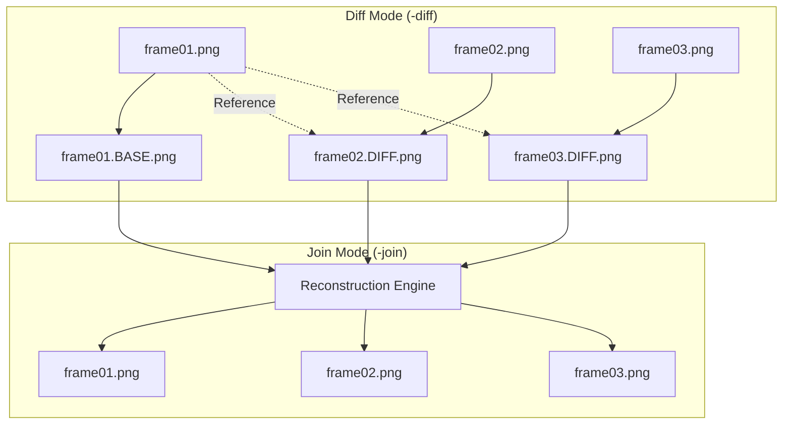

# Architecture

## Overview

Differ shrinks sequences of near-identical images by storing the initial frame whole (`.BASE.png`) and each successive frame as a sparse pixel diff (`.DIFF.png`). During reconstruction, it reapplies diff layers onto the base frame to restore original pixel data.

## Core Components

- **CLI Dispatcher (`main.go`):** Parses arguments for `-diff` and `-join` modes and validates input file lists.
- **Diff Processor:** Decodes source frames, compares each subsequent image against the base frame, and outputs changed pixels with full opacity while keeping unchanged pixels transparent.
- **Reconstruction Engine:** Decodes the base image and sequentially applies non-transparent pixel data from diff layers to regenerate exact source images.
- **Image I/O:** Decodes standard image formats (PNG, JPEG, GIF) and encodes resulting base and diff layers as PNG files.

## Invariants & Guarantees

- **Lossless Reconstruction:** Pixels with alpha 255 in diff frames overwrite the corresponding base pixel; unchanged pixels remain untouched.
- **In-place Naming:** Generated `.BASE` and `.DIFF` files are written directly to the directory of their input images.
- **Zero Runtime Dependencies:** Compiles into a single standalone binary with standard library image primitives.
